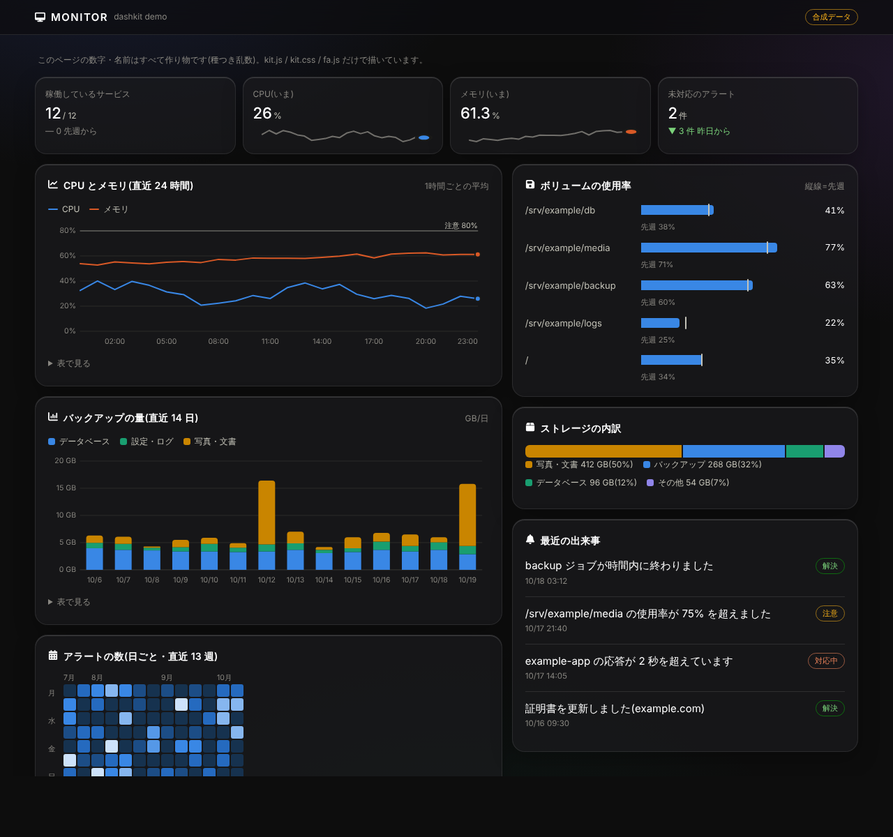
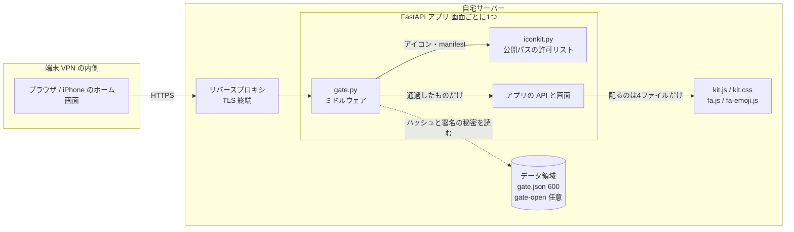
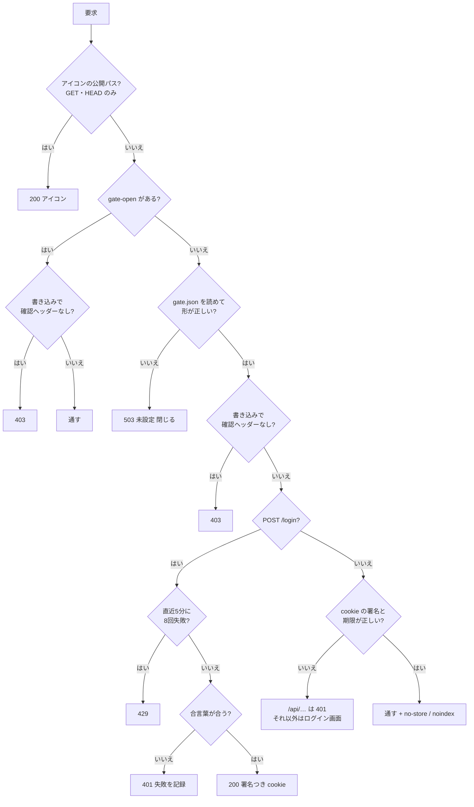
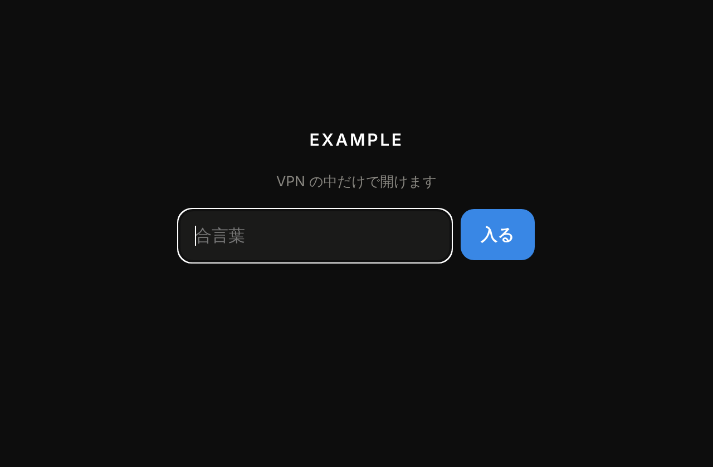
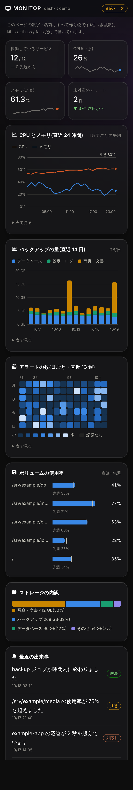

# dashkit

**Python 3.10–3.13 ・ 依存は FastAPI だけ ・ 試験 74 件 ・ ruff / mypy / 秘密の点検つき ・ 外部 CDN なし**

自宅サーバーで動かしている小さな Web ダッシュボード(監視・家計・メモなど)に**共通で使う部品**です。
ログインのゲート・ホーム画面のアイコン・グラフを、どの画面でも**同じ守り方・同じ見た目**にそろえるために作りました。



> 画面の数字・名前はすべて作り物です(`demo/index.html`。ファイルを開くだけで動きます)。

<details>
<summary>English summary</summary>

**dashkit** is a small set of shared building blocks for self-hosted web dashboards (monitoring, budgeting, notes) that run on a home server behind a VPN.

- **`gate.py`** – a passphrase gate as FastAPI middleware: PBKDF2-SHA256 (200k iterations) hash only, HMAC-signed cookies (`HttpOnly`, `SameSite=Lax`, `Secure` over HTTPS), global lockout after 8 failures in 5 minutes, a required `X-Requested-With` header on every write (CSRF), and **fail-closed** behaviour when the config is missing or corrupt.
- **`iconkit.py`** – serves home-screen icons and the web manifest on an explicit allow-list of public paths *before* authentication (iOS fetches icons without cookies).
- **`kit.js` / `kit.css`** – dependency-free, hand-written SVG charts (line, columns, bars, stacked, radar, calendar heatmap) with a table view and tooltips for every value; untrusted text always goes through `textContent` or `Kit.esc`.
- **`fa.js` / `fa_build.py`** – a vetted subset of Font Awesome Free bundled locally; the source SVGs are treated as untrusted input and only `viewBox` and a single `path` are accepted.

Design goals: nothing loaded from third-party CDNs, no secrets in code or arguments, deny by default.
Quality gates: 74 unit tests (boundary values, auth gate, failure modes, XSS escaping), ruff with security rules, mypy, and a small secret/internal-address scanner — all in one command, `sh scripts/check.sh`.
Limitations are listed honestly below (single shared passphrase, in-memory lockout, stateless cookies).

</details>

## 何を解決するか

| 困りごと | dashkit での答え |
|---|---|
| 画面を増やすたびに、ログイン・アイコン・グラフを作り直していた | 3つの部品にまとめ、`gate.install(app, ...)` の1行で同じ守りが入る |
| VPN の内側でも「入れた端末なら誰でも見える」は避けたい画面(家計など)がある | 合言葉のゲート。設定が無い・壊れているときは**閉じる** |
| 外の CDN を読むと、画面を開くたびに外へ通信が出る | 図もアイコンも自前。外部への要求はゼロ |
| iPhone のホーム画面に追加するとアイコンが出ない(ゲートの後ろにあるため) | アイコンと manifest だけを、許可リストの公開パスとして認証より前に返す |

## 構成



ゲートが1つの要求をどう扱うか(上から順に判定し、最初に当たったところで返す。`GET /login` と `POST /logout` の分かれ道は省いた):



| ファイル | 役割 |
|---|---|
| `gate.py` | 合言葉のログインゲート(FastAPI のミドルウェア) |
| `set_password.py` | 合言葉を標準入力から読み、ハッシュだけを `gate.json`(600)に書く |
| `iconkit.py` | ホーム画面用アイコン・manifest を公開パスとして返す(FastAPI / http.server / aiohttp) |
| `icons.py` | アイコンを SVG で描き、Chromium で 180/192/512 の PNG(透過なし)にする |
| `kit.js` / `kit.css` | 依存なしの手書き SVG グラフ・タブ・トースト・ダーク専用の見た目 |
| `fa.js` / `fa-emoji.js` / `fa_build.py` | Font Awesome Free の一部を取り込み、画面の絵文字を SVG アイコンに置き換える |
| `example/app.py` | 最小の使用例(ゲート + アイコン + グラフ1枚) |
| `demo/` | 静的なデモページ(合成データ)と、スクリーンショットを作り直すスクリプト |
| `scripts/` | `check.sh`(点検を全部回す)・`scan_private.py`(秘密・内部の住所の自己点検) |

## 使い方

```bash
pip install -r requirements-dev.txt                 # 本体に要るのは fastapi だけ(uvicorn は例を動かすとき)
python3 set_password.py ./example-data              # 合言葉を入力(画面に出ない・引数にも取らない)
uvicorn example.app:app --host 127.0.0.1 --port 8800
# → http://127.0.0.1:8800/
```

自分のアプリに入れるとき:

```python
import gate
gate.install(app, lambda: DATA_DIR, cookie="myapp_gate", title="MYAPP", header="myapp", icon="money")
```

- 画面側の `fetch` には `X-Requested-With: myapp` を付けます(`Kit.api('myapp')` が付けます)。
- 静的ファイルは**名前を決めて**配ります(`example/app.py` の `KIT_FILES`)。ディレクトリごと配ると `gate.json` まで見えてしまうためです。
- 合言葉なしで使う(VPN の中だけ): データ領域に `gate-open` という空のファイルを置く。書き込みの確認ヘッダーは残ります。消せば元に戻ります。

グラフの例(`demo/index.html` に全種類あります):

```js
Kit.line(document.getElementById('g'), {
  xs: ['10/1', '10/2', '10/3'],
  series: [{ name: '使用率', color: Kit.C.series[0], values: [41, 44, 43] }],
  yFmt: v => v + '%', refs: [{ y: 80, label: '注意 80%' }], label: 'ディスク使用率',
});
```

<p align="center">
  
  
</p>

## 設計の判断

### なぜこの作りか
- **ミドルウェア1つにまとめる**: ルートごとに `Depends` を付けると、付け忘れた1本が穴になる。全部の要求が必ず通る場所で判定し、例外(アイコン)は**許可リスト**で足す。
- **依存を増やさない**: 本体の依存は FastAPI だけ。グラフも手書きの SVG。家のサーバーで何年も放っておけること、更新のたびに中身を読み直せる量であることを優先した。
- **外の CDN を使わない**: 開くたびに外へ通信が出ない・外のサービスが落ちても画面が出る・取り込むものを自分で検査できる。Font Awesome も必要な分だけ検査して同梱した。
- **合言葉は1つ・利用者の区別なし**: 使うのは自分と家族の数台。アカウント管理を作るより、壊れにくさと読みやすさを取った(下の「制限」)。

### セキュリティの考え方
前提: 画面は VPN の内側だけで開き、リバースプロキシが TLS を終端する。守りたいのは「VPN に入れた別の端末・別のサイトからの書き込み・うっかりの設定ミス」。

| 脅威 | 対策 | 試験 |
|---|---|---|
| 合言葉が漏れる | ハッシュ(PBKDF2-SHA256・20万回・ソルト 16 バイト)だけを保存。引数に取らない(シェルの履歴・`ps` に残るため)。ファイルは 600 で、途中のファイルを残さず置き換える | `test_set_password`・`SetPasswordFileTest` |
| 総当たり | 5分間に8回失敗でロック(正しい合言葉でも 429)。確認ヘッダーの無い要求は数えない | `LockoutTest`(7回目まで可・8回で拒否・窓を過ぎたら解除) |
| 別サイトから書き込ませる(CSRF) | 書き込みは `X-Requested-With: <画面名>` が必須。独自ヘッダーは別サイトのフォームでは付けられず、`fetch` で付けると事前確認(CORS)で止まる。cookie は `SameSite=Lax` | `test_wrong_header_value_is_forbidden` ほか |
| cookie を盗む・作る | `HttpOnly`・HTTPS では `Secure`。値は「期限.HMAC-SHA256」で、比べるのは定数時間。合言葉を変えると署名の秘密も作り直し、全部の cookie が切れる | `CookieTest`(期限の境界・改ざん8通り・ASCII 以外) |
| 設定ミス・ファイルの破損 | `gate.json` が無い・JSON でない・形が違う → **503 で閉じる**(開いたままにならない) | `FailClosedTest`(7通りの壊れ方・途中で消えた) |
| 画面への文字の差し込み(XSS) | 外から来た文字は `textContent`、HTML に入れるときは必ず `Kit.esc` | `test_kit_js` |
| 取り込む第三者のデータ | Font Awesome の SVG を「信頼できない入力」として、`viewBox` と `path` 1本だけを正規表現で検査して取り込む | `test_fa_build` |
| 公開パスから中身が漏れる | アイコンは完全一致の許可リストだけ。GET/HEAD だけ。`/kit/../gate.py` などは返さない | `test_iconkit` |
| 検索エンジン・キャッシュ | 通した応答に `X-Robots-Tag: noindex`、API は `Cache-Control: no-store` | `test_cache_and_robots_headers` |

**秘密を置かない**: このリポジトリには鍵・トークン・合言葉・内部のアドレスを入れません。例の値は `127.0.0.1`・`example.com`・`/srv/example` だけです。`scripts/scan_private.py` が、git の追跡するファイルから秘密鍵・トークンの形・IP・メール・`/mnt` などのパスを探します(gitleaks の代わりではなく、うっかりを早く見つけるための網)。

## 試験の回し方

```bash
pip install -r requirements-dev.txt
sh scripts/check.sh          # ruff → mypy → 秘密の点検 → 試験(74 件)。どれか落ちたら止まる
python3 -m unittest discover -s tests -v    # 試験だけ
```

- 試験は**一時ディレクトリと 127.0.0.1 だけ**を使い、外のネットワークには出ません。root も要りません。
- `kit.js` の試験は node があれば回ります(無ければ飛ばします)。
- 時間に関わる試験(ロックの窓・cookie の期限)は `time.time` を差し替えて、待たずに境界を確かめます。

| 試験のファイル | 見ていること |
|---|---|
| `test_gate.py` | ふつうの流れ(ログイン・書き込みの確認・合言葉の変更・ロック・gate-open) |
| `test_gate_edges.py` | 境界値と失敗時(ロックの境界・cookie の改ざんと期限・壊れた設定で閉じる・cookie の属性・権限 600) |
| `test_set_password.py` | 合言葉を画面にもファイルにも出さない・短すぎる合言葉を断る・作り直し |
| `test_iconkit.py` | アイコンの形(透過なし)・公開パスの完全一致・ファイルが無いとき・http.server と FastAPI |
| `test_fa_build.py` | 取り込む SVG の検査(形の違うものは止める) |
| `test_kit_js.py` | `Kit.esc`・表と凡例の逃がし・金額の書き方の境界・メーターの範囲 |
| `test_scan_private.py` | 自己点検が拾うべきものを拾い、作り物の例は通すこと |

**CI**: GitHub Actions は使いません(このリポジトリの約束)。同じ点検は `sh scripts/check.sh` で手元で全部回せます。

スクリーンショットの作り直し: `CHROME=<Chromium の実行ファイル> python3 -I demo/screenshots.py`

## 制限(わかっていて割り切ったこと)
- **合言葉は1つ**。利用者の区別・権限の段階はありません。
- **ロックは全体で数える**。リバースプロキシ経由では送信元がみな同じに見えるためです。そのぶん、誰かがわざと間違え続けると持ち主も5分入れません(VPN の内側なので受け入れた)。
- **ロックの記録はプロセスのメモリ**。再起動で消え、複数ワーカーではワーカーごとに数えます(1ワーカーで動かす前提)。
- **cookie は失効リストを持たない**(状態を持たない署名方式)。ログアウトは端末の cookie を消すだけで、写し取られた cookie は期限(180 日)まで使えます。全部を切るには合言葉を変えます。
- `X-Forwarded-Proto` を信じるのは `Secure` を付けるかどうかだけです(付け過ぎる方向にしか効かない)。
- Content-Security-Policy は付けていません(画面がインラインの script を使うため。各画面で付けるのが次の課題)。
- 見た目はダーク専用。確かめているのは主に iPhone の Safari と PC の Chromium です。

## 失敗から学んだこと
- **iPhone のホーム画面アイコンが変わらない**: iOS はアイコンをサイト単位で長く覚えていて、`?v=2` のようなクエリでは取り直さなかった。**ファイル名そのものを変える**(`/icon-v3-180.png`)ことで解決。また manifest に SVG(`sizes: any`)を入れると、iOS がそれを選んで描けず、ページの縮小画像になることがあったので、manifest は PNG だけにした。
- **ゲートの後ろのアイコンが取れない**: iOS はアイコンを cookie なしで取りに来るので、ログイン画面のアイコンになっていた。アイコンと manifest だけを、認証より前に返す公開パスにした(それ以外のパスは試験で「返さない」ことを確認)。
- **絵文字の置き換えでボタンが効かなくなった**: アイコンの `<svg>` が押した先(`e.target`)になり、クラスで判定していた画面が壊れた。置き換えた要素に `pointer-events:none` を付け、判定は文字ではなく data 属性・クラスで行うようにした。
- CSS のクラス名を短い一般名(`.top` など)にしたら、既存の画面と衝突した。部品側は `kit-` で始める。
- **壊れた設定で 500 になっていた**: `gate.json` の形が違うときや、ASCII 以外を含む cookie が来たとき、閉じてはいたが例外(500)だった。試験で見つけ、503 / 401 で静かに断るよう直した。

## AI の使い方と、自分がしたこと
- コードの大部分は **Claude Code(AI)** に書かせました。
- 自分が決めたこと: VPN の内側だけで開く方針と、どの画面にゲートを付けるか。
- 自分が確認したこと: iPhone のホーム画面に追加したときのアイコンの出方(上の「失敗から学んだこと」の1つ目)。
- 公開用に整理する際(2026-10)、自分の画面の名前やアドレスを抜き、ゲートの試験と使用例を足しました。

## ライセンス
- このリポジトリのコード: ライセンスは未設定です(すべての権利を保持)。
- `fa.js` に含まれるアイコン: Font Awesome Free 6.6.0(Icons: CC BY 4.0、Copyright Fonticons, Inc.)。全文は `fa-LICENSE.txt`。
